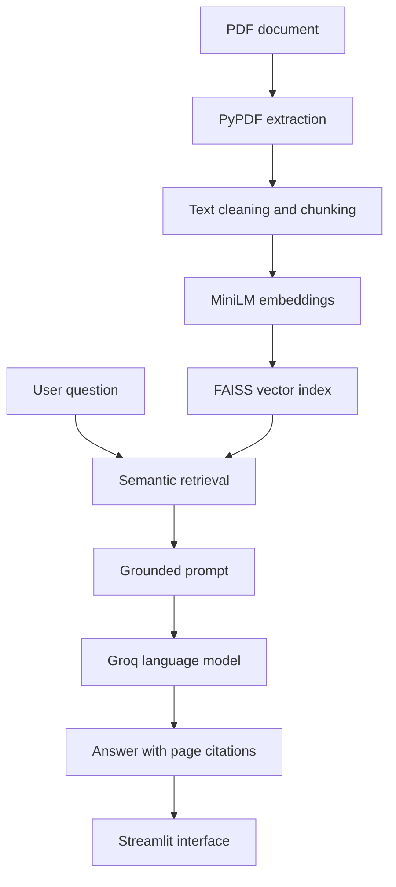

# Intelligent Document Assistant using RAG

An end-to-end Retrieval-Augmented Generation (RAG) application that extracts information from PDF documents and answers user questions with grounded page citations.

The project combines open-source sentence embeddings, FAISS semantic search, LangGraph orchestration, Groq language-model inference, automated evaluation, and a Streamlit web interface.

## Project Overview

Large PDF documents are difficult to search manually. A general language model may also produce answers that are unsupported by the source document.

This project solves that problem by:

1. Extracting text and page metadata from a PDF.
2. Cleaning and dividing the text into overlapping chunks.
3. Converting chunks into semantic embeddings.
4. Storing embeddings in a FAISS vector index.
5. Retrieving the most relevant chunks for each question.
6. Sending only the retrieved evidence to the language model.
7. Returning a grounded answer with page citations.

## Main Features

- Searchable PDF upload
- Page-by-page text extraction
- Text cleaning and normalization
- Comparison of multiple chunk sizes
- Open-source MiniLM embeddings
- FAISS vector similarity search
- LangGraph retrieval and generation workflow
- Groq language-model integration
- Grounded prompt template
- Page-level source citations
- Out-of-document refusal behavior
- Streamlit conversational interface
- Automated RAG evaluation
- Evaluation charts and reports
- Secure API-key configuration

## System Architecture



Detailed architecture documentation is available in [`docs/architecture.md`](docs/architecture.md).

## Technology Stack

| Technology | Purpose |
|---|---|
| Python 3.12 | Programming language |
| PyPDF | PDF text extraction |
| LangChain | Document, prompt, splitter, and model components |
| LangGraph | RAG workflow orchestration |
| Sentence Transformers | Open-source embeddings |
| all-MiniLM-L6-v2 | 384-dimensional embedding model |
| FAISS | Vector storage and semantic retrieval |
| Groq | Fast language-model inference |
| openai/gpt-oss-20b | Answer generation |
| Streamlit | Interactive web interface |
| Pandas | Evaluation result storage |
| Matplotlib | Evaluation visualization |

## Project Structure

```text
Intelligent_Document_Assistant_RAG/
│
├── app.py
├── README.md
├── requirements.txt
├── .gitignore
├── .env
│
├── data/
│   ├── raw/
│   │   └── apple_2024_annual_report.pdf
│   └── processed/
│       ├── apple_2024_cleaned.txt
│       └── chunks_1000_200.json
│
├── docs/
│   └── architecture.md
│
├── notebooks/
│
├── reports/
│   ├── chunk_size_comparison.csv
│   ├── vector_store_summary.json
│   ├── rag_evaluation_results.csv
│   ├── rag_evaluation_summary.json
│   └── rag_evaluation_chart.png
│
├── src/
│   ├── __init__.py
│   ├── document_processor.py
│   ├── text_chunker.py
│   ├── vector_store.py
│   ├── retriever.py
│   ├── rag_pipeline.py
│   └── evaluate_rag.py
│
└── vector_store/
    └── faiss_index/
        ├── index.faiss
        └── index.pkl
```

> The `.env` file is private and must never be committed to GitHub.

## Dataset

The development document is the Apple 2024 Annual Report.

Document-processing statistics:

| Measurement | Result |
|---|---:|
| Total PDF pages | 121 |
| Pages containing extractable text | 121 |
| Cleaned characters | 409,338 |
| Selected text chunks | 544 |
| Embedding dimensions | 384 |

The Streamlit application can also process other searchable PDF documents uploaded by the user.

## Chunk-Size Comparison

Three configurations were evaluated:

| Chunk size | Overlap | Number of chunks | Average chunk length |
|---:|---:|---:|---:|
| 500 | 100 | 1,008 | 419.01 |
| 1,000 | 200 | 544 | 865.73 |
| 1,500 | 300 | 370 | 1,257.17 |

The selected configuration is:

```text
Chunk size: 1000
Chunk overlap: 200
```

It provides enough context for financial tables and paragraphs while keeping retrieved content focused.

## Installation

### 1. Clone the repository

```powershell
git clone YOUR_REPOSITORY_URL
cd Intelligent_Document_Assistant_RAG
```

### 2. Create a virtual environment

```powershell
python -m venv venv
```

### 3. Allow activation for the current PowerShell session

```powershell
Set-ExecutionPolicy -Scope Process -ExecutionPolicy RemoteSigned
```

### 4. Activate the environment

```powershell
.\venv\Scripts\Activate.ps1
```

### 5. Install dependencies

```powershell
python -m pip install --upgrade pip
pip install -r requirements.txt
```

## Environment Configuration

Create a root `.env` file:

```env
GROQ_API_KEY=your_private_groq_api_key
GROQ_MODEL=openai/gpt-oss-20b
```

Never place the real API key in source code, screenshots, documentation, or GitHub.

## Running the Data Pipeline

All commands must be run from the project root with the virtual environment active.

### 1. Extract and clean the PDF

```powershell
python src/document_processor.py
```

Output:

```text
data/processed/apple_2024_cleaned.txt
```

### 2. Compare and create chunks

```powershell
python -m src.text_chunker
```

Outputs:

```text
data/processed/chunks_1000_200.json
reports/chunk_size_comparison.csv
```

### 3. Build the FAISS vector index

```powershell
python -m src.vector_store
```

Outputs:

```text
vector_store/faiss_index
reports/vector_store_summary.json
```

### 4. Test semantic retrieval

```powershell
python -m src.retriever
```

### 5. Test the complete LangGraph RAG pipeline

```powershell
python -m src.rag_pipeline
```

Example question:

```text
What were Apple's total net sales in 2024?
```

Example grounded answer:

```text
Apple's total net sales for fiscal 2024 were $391,035 million.
```

## Running the Streamlit Application

Start the application with:

```powershell
streamlit run app.py
```

Then:

1. Upload a searchable PDF.
2. Click **Process PDF**.
3. Wait for the FAISS index to be created.
4. Ask questions in the chat box.
5. Review the generated answer and retrieved pages.

The first run may take longer because the embedding model must be downloaded and loaded.

## Automated Evaluation

Run:

```powershell
python -m src.evaluate_rag
```

The evaluation measures:

- Answer keyword accuracy
- Retrieval hit rate
- Citation grounding rate
- Unsupported-question refusal accuracy
- Overall pass rate
- Average response time

### Evaluation Results

| Metric | Score |
|---|---:|
| Answer accuracy | 100% |
| Retrieval hit rate | 100% |
| Citation grounding rate | 100% |
| Refusal accuracy | 100% |
| Overall pass rate | 100% |
| Average response time | 0.66 seconds |

Evaluation artifacts:

```text
reports/rag_evaluation_results.csv
reports/rag_evaluation_summary.json
reports/rag_evaluation_chart.png
```

## Grounding and Hallucination Control

The prompt instructs the language model to:

- Use only retrieved PDF context.
- Avoid outside knowledge.
- Cite supporting document pages.
- Avoid inventing figures or page numbers.
- Refuse questions unsupported by the document.

The temperature is set to `0` to make answers more consistent and deterministic.

## Why FAISS?

FAISS provides efficient similarity search over dense numerical vectors. It allows the system to retrieve semantically related document sections even when the wording of the user's question differs from the wording used in the PDF.

## Why Chunk Overlap?

Important information can be divided across chunk boundaries. A 200-character overlap repeats a small portion of neighboring text, reducing the chance that essential context is lost.

## Why RAG?

RAG improves document question answering by combining:

- The retrieval ability of a vector database
- The language-generation ability of an LLM
- Evidence from the uploaded source document

This reduces hallucination and makes answers traceable through citations.

## Deployment on Streamlit Community Cloud

1. Push the project to a GitHub repository.
2. Open Streamlit Community Cloud.
3. Select the GitHub repository.
4. Choose `app.py` as the main file.
5. Add the following under application secrets:

```toml
GROQ_API_KEY = "your_private_groq_api_key"
GROQ_MODEL = "openai/gpt-oss-20b"
```

6. Deploy the application.

Do not upload the local `.env` file.

## Limitations

- Image-only PDFs are not readable without OCR.
- Very large PDFs require more processing time and memory.
- Answer quality depends on retrieved chunks.
- The current evaluation set contains five representative questions.
- The application requires an internet connection for Groq inference.
- Complex tables may not always preserve their original visual structure.

## Future Improvements

- Add OCR support for scanned PDFs.
- Support multiple PDFs in one session.
- Add hybrid keyword and semantic retrieval.
- Add a cross-encoder reranker.
- Add conversation-aware follow-up questions.
- Expand the evaluation dataset.
- Add downloadable chat history.
- Add user authentication for production deployment.

## Security

- API keys are loaded from environment variables.
- `.env` is excluded through `.gitignore`.
- Streamlit secrets are used during deployment.
- No API key is hard-coded.
- Uploaded PDFs are processed within the active application session.

## Project Status

The complete RAG pipeline, Streamlit interface, source citations, automated evaluation, reports, and documentation are implemented and tested successfully.