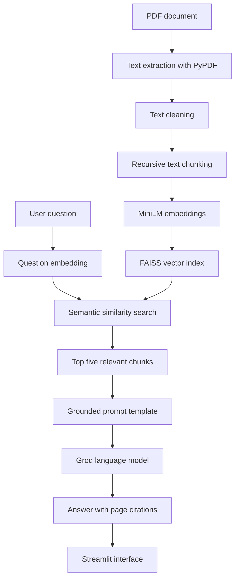
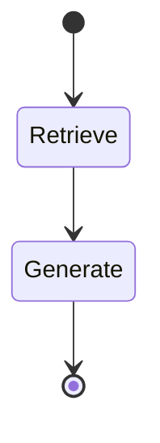
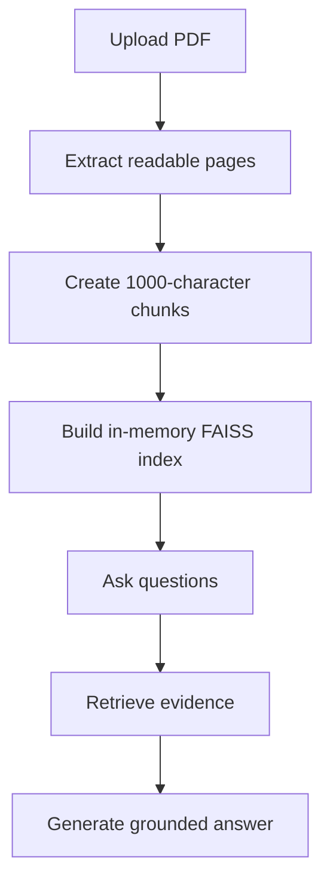

# Intelligent Document Assistant — System Architecture

## 1. Architecture Overview

The Intelligent Document Assistant uses Retrieval-Augmented Generation (RAG) to answer questions from PDF documents.

Instead of asking the language model to answer from its general knowledge, the system first retrieves relevant text from the uploaded document. The retrieved evidence is then supplied to the language model to generate a grounded answer with page citations.

## 2. End-to-End Architecture

## 3. Document Processing Flow

| Stage | Component | Purpose |
|---|---|---|
| PDF loading | PyPDF | Reads the PDF and extracts text page by page |
| Text cleaning | `document_processor.py` | Removes unnecessary spaces and formatting problems |
| Text chunking | `text_chunker.py` | Divides long text into smaller overlapping sections |
| Embedding | `all-MiniLM-L6-v2` | Converts each chunk into a 384-dimensional numerical vector |
| Vector storage | FAISS | Stores vectors and performs fast similarity searches |
| Retrieval | `retriever.py` | Finds the five chunks most relevant to a question |
| Orchestration | LangGraph | Controls the retrieve and generate workflow |
| Generation | Groq LLM | Generates an answer using only retrieved evidence |
| User interface | Streamlit | Provides PDF upload and conversational question answering |
| Evaluation | `evaluate_rag.py` | Measures retrieval, answers, citations, refusals, and latency |

## 4. Offline Indexing Pipeline

The command-line pipeline prepares the Apple annual report before questions are asked.

1. `document_processor.py` extracts and cleans text from every readable PDF page.
2. `text_chunker.py` compares multiple chunk configurations.
3. The selected configuration uses a chunk size of **1,000 characters** with **200 characters of overlap**.
4. `vector_store.py` converts the chunks into embeddings.
5. FAISS saves the searchable vector index in `vector_store/faiss_index`.

The overlap preserves context that may otherwise be divided between two neighboring chunks.

## 5. Online Question-Answering Pipeline

When the user asks a question:

1. The same MiniLM model converts the question into an embedding.
2. FAISS compares the question vector with stored document vectors.
3. The system retrieves the five closest document chunks.
4. Page metadata and retrieved text are inserted into the prompt.
5. The Groq language model receives the question and evidence.
6. The model produces a concise answer with page citations.
7. If the evidence does not contain the answer, the model returns a refusal message.

## 6. LangGraph Workflow

### Retrieve Node

The retrieve node:

- Converts the question into an embedding.
- Searches the FAISS index.
- Returns relevant document chunks.
- Preserves source and page metadata.

### Generate Node

The generate node:

- Builds a grounded prompt.
- Supplies the retrieved evidence to the language model.
- Prevents unsupported outside knowledge.
- Produces the final answer and page citations.

## 7. Streamlit Upload Workflow

The Streamlit application supports dynamically uploaded searchable PDFs.

The uploaded document index remains in the Streamlit session and is replaced when a different PDF is processed.

Image-only or scanned PDFs require Optical Character Recognition (OCR) before text can be indexed.

## 8. Main Technologies

| Technology | Role |
|---|---|
| Python 3.12 | Primary programming language |
| PyPDF | PDF text extraction |
| LangChain | Documents, prompts, splitting, and model integrations |
| LangGraph | RAG workflow orchestration |
| Sentence Transformers | Open-source text embeddings |
| all-MiniLM-L6-v2 | 384-dimensional embedding model |
| FAISS | Vector storage and semantic search |
| Groq | Fast language-model inference |
| openai/gpt-oss-20b | Grounded answer generation |
| Streamlit | Interactive web application |
| Pandas | Evaluation result storage |
| Matplotlib | Evaluation chart generation |

## 9. Project Modules

| File | Responsibility |
|---|---|
| `src/document_processor.py` | PDF extraction and cleaning |
| `src/text_chunker.py` | Chunk comparison and selected chunk creation |
| `src/vector_store.py` | Embedding generation and FAISS indexing |
| `src/retriever.py` | Similarity search and ranked retrieval |
| `src/rag_pipeline.py` | LangGraph retrieval and generation pipeline |
| `src/evaluate_rag.py` | Automated RAG evaluation |
| `app.py` | Streamlit PDF question-answering interface |

## 10. Generated Artifacts

| Artifact | Location |
|---|---|
| Cleaned PDF text | `data/processed/apple_2024_cleaned.txt` |
| Selected text chunks | `data/processed/chunks_1000_200.json` |
| FAISS vector index | `vector_store/faiss_index` |
| Chunk comparison | `reports/chunk_size_comparison.csv` |
| Vector-store summary | `reports/vector_store_summary.json` |
| Evaluation results | `reports/rag_evaluation_results.csv` |
| Evaluation summary | `reports/rag_evaluation_summary.json` |
| Evaluation chart | `reports/rag_evaluation_chart.png` |

## 11. Security Design

- The Groq API key is stored in the `.env` file during local development.
- `.env` is excluded from Git using `.gitignore`.
- Streamlit deployment uses encrypted application secrets.
- The API key is never hard-coded into Python files.
- Uploaded PDFs are processed inside the current application session.

## 12. Evaluation Results

The automated evaluation produced:

- Answer accuracy: **100%**
- Retrieval hit rate: **100%**
- Citation grounding rate: **100%**
- Out-of-document refusal accuracy: **100%**
- Overall pass rate: **100%**
- Average response time: **0.66 seconds**

These results demonstrate that the tested questions were answered accurately using retrieved evidence and grounded page citations.